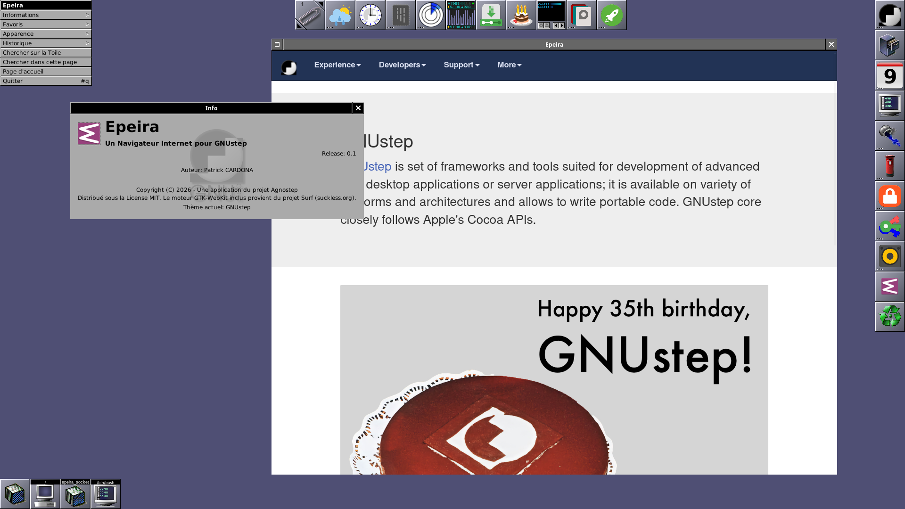

# Epeira

AGNoStep Apps
(c) 2026 - Patrick Cardona

Thanks for the GNUstep Developers Community.
This is Free and Open Source software.
Read [LICENSE](./LICENSE) in the root directory.

# What is Epeira?

This is a **GNUstep Web Browser** and **Service**. Its name comes from a latin word to name a common spider species.



The Web window is an X embedded [Surf](https://suckless.org/Surf) browser instance, which provides a complete **Gtk-WebKit Engine**. It is displayed within the GNUstep application thanks to a *Helper*:  `epeira_socket`.

> [!WARNING]
> As Epeira uses an xembedded window, it is targetted to an **Xserver** Desktop. It will NOT work on Wayland.

The **favorites** are handled with **Internet Shortcuts**, i.e. '*.url' in the home `Favorites` folder. The code of this part was derived from the previous `SaveLink.app`.

Default **Web search** is performed with **Duckduckgo** by default.

A minimal **History** is also provided: back and forward. To get more, use the right-clic on the page.

**Bookmarking** the current page is provided by a save url Panel.

You can also toggle to Dark mode and zoom in/out the page.

> [!NOTE]
> **Password management** will be provided with a service from the new `Pass.app` release (to be done).

# Dependencies

**Epeira** depends on:
- A complete **GNUstep System**:  
see by example [Agnostep Desktop](https://github.com/pcardona34/agnostep-desktop).
- The **Renaissance** framework.
- **Surf** browser is provided by [Suckless dot Org](https://suckless.org/Surf).
- `HelpViewer.app` to display the Help content.
- New `Pass.app` release to get the **password management** service (to be done).

# Localization

Epeira has been localized in:

- English (default)
- French.

# Install

It needs only a few minutes.

You must have superuser privileges to type your password when asked.

Execute:

```console
git clone https://github.com/pcardona34/Epeira.git
cd Epeira
bash ./install.sh
```

This will fetch dependencies (until now, only on Debian Trixie), install Scripts and Conf, build and install the Helper and the Web Browser.

# Using

```console
openapp Epeira
```

Or run it from the `Applications` folder.

# Using the Service

- Select an URL;
- From the menu, do: `Services/Open URL with Epeira`.

# Help

Help is provided from `Info/Help...` menu.
